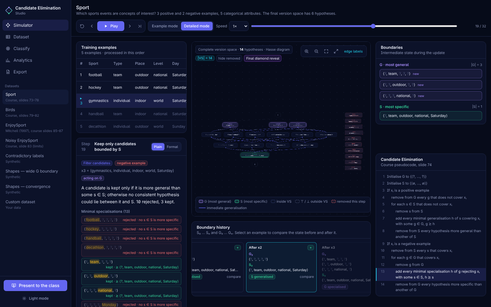
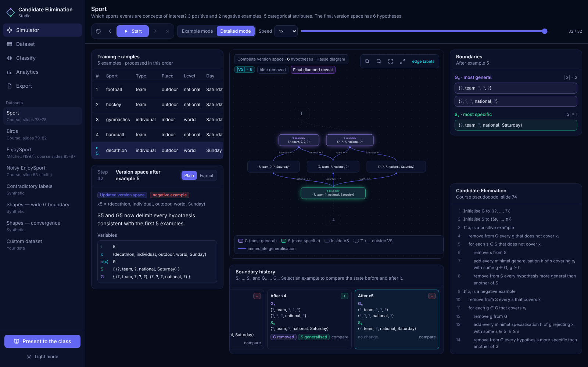
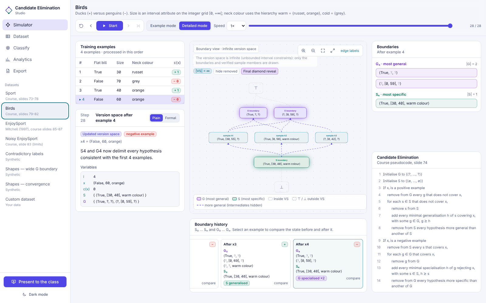
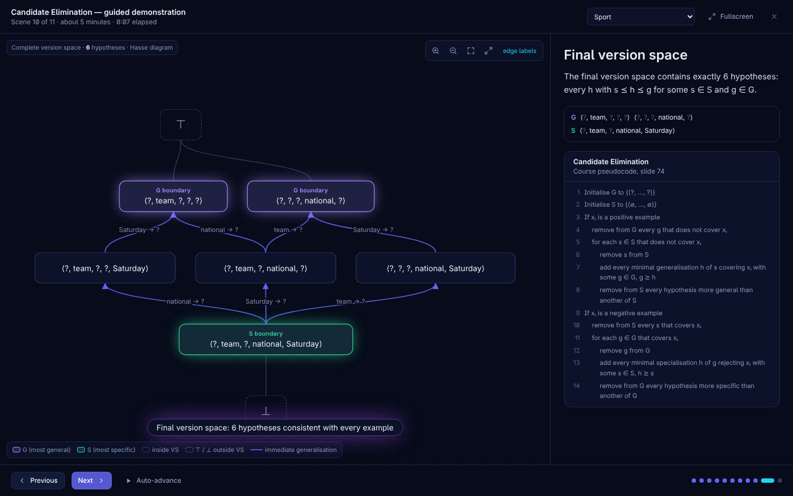
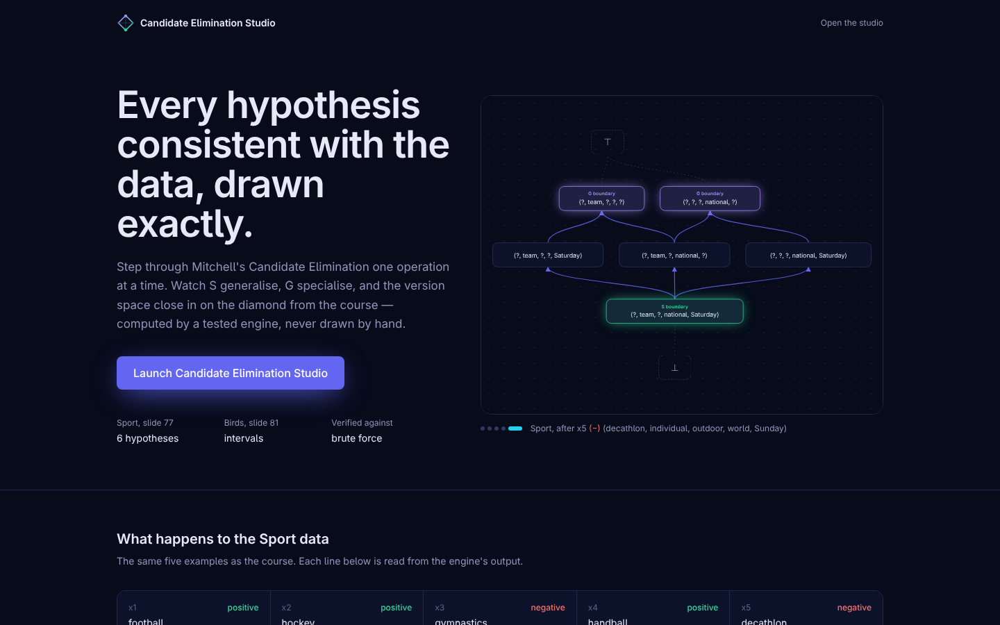

# Candidate Elimination Studio — Interactive Version Space Visualizer


**🚀 Live demo: [candidate-elimination-studio.vercel.app/studio](https://candidate-elimination-studio.vercel.app/studio)**

An interactive, mathematically exact web application for **Mitchell's Candidate Elimination algorithm**: the **S** and **G** boundaries, every internal operation of the algorithm, and the **version space drawn as its real Hasse diagram**. It includes an exact engine, a step-by-step simulator, a lattice visualisation, classification of new instances, a dataset importer/editor, a guided presentation mode, exports, automated testing and CI.

> **Scope:** The project implements one algorithm only — no other learners and no model comparison. Results depend on the chosen hypothesis language (see [Hypothesis language](#hypothesis-language)).

---

## Project Date

**October 2026**

---

## Overview

Candidate Elimination maintains, for a concept-learning problem, the set of all hypotheses consistent with the training examples (the *version space*) through two boundaries: **S**, the most specific, and **G**, the most general. This project makes that process visible and verifiable.

The repository covers the full workflow:

- A framework-free, typed, unit-tested algorithm engine
- Reference datasets (Sport, Birds, EnjoySport) and synthetic datasets
- A step-by-step simulator (example mode and detailed mode)
- A version space lattice computed from the real boundaries and laid out with ELK
- Classification of new instances with exact evidence
- Analytics read from the run
- CSV / Excel / JSON dataset import with a wizard, and a dataset editor
- A guided fullscreen presentation mode
- Exports (JSON, CSV, SVG, PNG, PDF)
- Brute-force verification of the engine
- Unit tests, end-to-end tests and GitHub Actions CI
- One-click deployment on Vercel

The application is an **educational tool**: every number and every diagram comes from the engine's real trace, never from hand-drawn data.

---

## Research Question

> Can the version space of a concept-learning problem be computed **exactly** and explained **one operation at a time**, including S generalising, G specialising and the final diamond of consistent hypotheses?

---

## Datasets

The studio ships with seven datasets.

| Dataset | Source | What it demonstrates |
|---|---|---|
| **Sport** | Reference example | 5 examples, 5 categorical attributes; final version space of **6 hypotheses** (the diamond) |
| **Birds** | Reference example | Interval attribute (size) and warm/cold colour hierarchy; infinite version space shown as boundaries + verified samples |
| **EnjoySport** | Mitchell (1997) | Classic example and classification of new instances |
| **Noisy EnjoySport** | Reference example | Effect of a noisy label |
| **Contradictory labels** | Synthetic | Conflicting examples: the version space becomes empty |
| **Shapes — wide G boundary** | Synthetic | A G boundary with several members |
| **Shapes — convergence** | Synthetic | Convergence to S = G |

Datasets are available as re-importable JSON and CSV in [`fixtures/`](fixtures). You can also import your own data (see [Dataset JSON format](#dataset-json-format)).

---

## Algorithm Workflow

```text
Dataset (attributes, domains, hierarchies, examples)
    ↓
Hypothesis language (?, ∅, values, groups, intervals)
    ↓
Initialise  S₀ = {⟨∅,…,∅⟩}   G₀ = {⟨?,…,?⟩}
    ↓
For each training example
    ├─ Positive:  prune G → minimally generalise S → prune S
    └─ Negative:  prune S → minimally specialise G → prune G
    ↓
Immutable trace (every step, candidate, witness and rejection reason)
    ↓
Version space enumeration / boundary view
    ↓
Lattice (ELK layered layout)   +   Classification   +   Analytics   +   Exports
```

The whole run is stored as an **immutable trace**. The simulator, the lattice, the timeline, the pseudocode highlighter and the exports are all different views over that single trace, so they are always synchronised.

---

## Features

### Exact engine (`src/lib/ce`)

- Typed constraints: `?`, `∅`, categorical values, hierarchy groups, closed intervals and missing values
- Generality order between hypotheses
- Minimal generalisations and minimal specialisations
- `updateS`, `updateG` and `candidateElimination`
- `enumerateVersionSpace` and `classifyWithVersionSpace`
- Framework-free and unit-tested, with brute-force verification

### Step-by-step simulator

- Start, Previous, Next, Play / Pause, Reset
- Jump-to-step scrubber and adjustable playback speed
- **Example mode**: one step per training example
- **Detailed mode**: present → filter → select → generate → filter candidates → prune → result
- Keyboard shortcuts: `←` `→` `Space` `Home` `End`

### Version space lattice

- Computed from the current boundaries and laid out with ELK (layered, general on top)
- Complete Hasse diagram when the version space has ≤ 120 members; otherwise a clearly labelled boundary view (for example Birds, whose version space is infinite)
- Zoom, pan, fit-to-view and **fullscreen**
- Node details with the consistency of the hypothesis for every example
- Highlighted paths to more general (violet) and more specific (emerald) hypotheses
- Removed hypotheses, edge labels such as `Saturday → ?`, and a **Final diamond reveal**

### Synchronised panels

- Training table
- Explanation of each step, in plain language or formal notation
- The algorithm's pseudocode with the active line highlighted
- Variables and consistency checks
- Every candidate, with the witness that keeps it or the reason it is rejected
- S and G cards
- S₀…Sₙ / G₀…Gₙ timeline with before/after comparison

### Classification of new instances

- Verdicts: definitely positive, definitely negative, undetermined, or no consistent hypothesis
- Constraint-by-constraint evidence
- Exact vote counts (never probabilities)
- Ready-made instances to try the classifier

### Analytics

- Processed examples, |S|, |G| and exact |VS|
- Candidates generated and eliminated
- Computation time
- Version space evolution, all read from the run

### Datasets: import and editor

- Drag-and-drop **CSV / Excel (.xlsx) / JSON** import
- Import wizard: column roles, class column, positive values, and interval / discretisation / categorical representation for numeric columns
- Validation with explicit error messages that block the run
- Editor for attributes, domains, hierarchies and examples (add, remove, edit, reorder)

### Presentation mode

A guided, fullscreen demonstration of Sport (S₀/G₀, first positive example, minimal generalisation, the negative example and the specialisation of G, final reveal and reading of the diamond), driven by the real trace.

### Exports

- Results JSON
- S / G history as CSV and JSON
- Final lattice as SVG and PNG
- Step-by-step PDF report
- Dataset JSON

### Interface

- Dark and light themes
- Responsive layout (desktop and mobile)
- Respect of `prefers-reduced-motion`

---

## Application Pages

```text
🎬 Landing page   (/)
🧪 Studio         (/studio)
      ├─ Simulator   — playback, panels, lattice, timeline
      ├─ Dataset     — import wizard and editor
      ├─ Classify    — classification of new instances
      ├─ Analytics   — run statistics
      └─ Export      — JSON, CSV, SVG, PNG, PDF
🎓 Presentation mode (fullscreen guided demo)
🔌 POST /api/run     (optional server-side route running the same engine)
```

---

## Screenshots

### Detailed step: specialising G (Sport, example 3)



### Final Sport version space



### Birds, light mode



### Presentation mode



### Landing



To regenerate screenshots: `npm run build && npm start`, open `http://localhost:3000/studio`, and capture at 1600×1000 (or run the Playwright suite with `--trace on`).

---

## Project Structure

```text
candidate-elimination-studio/
│
├── README.md
├── LICENSE
├── package.json
├── next.config.mjs
├── tsconfig.json
├── eslint.config.mjs
├── vitest.config.mts
├── playwright.config.ts
│
├── .github/
│   └── workflows/
│       └── ci.yml
│
├── src/
│   ├── app/                  Next.js App Router: landing (/), studio (/studio), api/run
│   ├── lib/
│   │   ├── ce/               the engine — types, space (per-attribute lattices), hypothesis
│   │   │                     operations, algorithm + trace, version space / lattice /
│   │   │                     classification, format, parse
│   │   ├── datasets/         reference and synthetic datasets
│   │   ├── io/               CSV parser, XLSX reader, JSON schema (Zod), import wizard logic
│   │   ├── export/           JSON / CSV / SVG exports and a dependency-free PDF writer
│   │   ├── layout.ts         ELK layout of the lattice (+ deterministic fallback)
│   │   └── presentation.ts   scenes of the guided demo, built from the trace
│   ├── store/
│   │   └── studio.ts         Zustand store (index into the immutable trace)
│   └── components/           lattice view, studio panels, shadcn-style UI primitives
│
├── tests/
│   ├── unit/                 Vitest: reference regressions, brute force, trace, IO, exports
│   └── e2e/                  Playwright: playback, lattice, Birds, collapse, import,
│                             editing, export, presentation, mobile
│
├── fixtures/                 reference datasets as JSON (re-importable) and CSV
│
├── docs/
│   ├── ALGORITHM.md          the mathematics and the verification strategy
│   ├── demo.gif              animated demo shown at the top of this README
│   └── screenshots/
│
└── demo-video/
    └── record.cjs            Playwright script that records the demo walkthrough
```

---

# Installation

Requires **Node.js ≥ 20.9**.

## 1. Clone the Repository

```bash
git clone https://github.com/arefbakali/candidate-elimination-studio.git
cd candidate-elimination-studio
```

## 2. Install Dependencies

```bash
npm install
```

## 3. Run the Application

```bash
npm run dev
```

Then open:

```text
http://localhost:3000
```

## 4. Production Build (optional)

```bash
npm run build
npm start
```

---

# Dataset JSON format

```json
{
  "name": "Birds",
  "attributes": [
    { "kind": "categorical", "name": "Flat bill", "values": ["True", "False"] },
    { "kind": "interval", "name": "Size", "min": 0, "max": "inf", "step": 1 },
    { "kind": "categorical", "name": "Neck colour", "values": ["russet", "orange", "grey"],
      "hierarchy": [{ "name": "warm colour", "members": ["russet", "orange"] },
                    { "name": "cold colour", "members": ["grey"] }] }
  ],
  "examples": [{ "id": "duck 1", "values": ["True", 30, "russet"], "label": true }]
}
```

`null` is a missing value. Arrays of records (`[{"Sky": "Sunny", …, "Enjoy": "Yes"}]`) and CSV / XLSX tables open the import wizard instead.

---

# Hypothesis language

Candidate Elimination is only defined relative to a **hypothesis language**. This app supports conjunctions whose constraints are, per attribute:

- a categorical value or `?`;
- a node of a tree hierarchy of values;
- a closed interval on a numeric grid `min + k·step`.

Raw continuous columns must be given a grid (interval mode) or discretised into bins; the wizard asks for this explicitly. See [docs/ALGORITHM.md](docs/ALGORITHM.md) for the definitions and why each operation is minimal.

---

# Testing

| Command | What it does |
|---|---|
| `npm test` | Vitest unit tests (engine, reference regressions, brute force, importers, exports) |
| `npm run test:e2e` | Playwright browser tests (builds and starts the app) |
| `npm run lint` | ESLint (Next.js rules) |
| `npm run typecheck` | `tsc --noEmit` |
| `npm run build` | Production build |
| `npm run check` | Lint, typecheck, unit tests and build in one go |

The tests verify, among other things, that:

- the Sport run ends with a version space of **6 hypotheses**, S = `⟨?, team, ?, national, Saturday⟩` and two G members;
- Birds uses interval hypotheses and produces a boundary view for its infinite version space;
- contradictory data empties the version space;
- the classification verdicts of the EnjoySport example are reproduced;
- importing `sport.csv` through the wizard reproduces the reference result;
- editing errors are reported and block the run;
- exported JSON, SVG, PNG and PDF files match the computed result;
- the presentation mode runs on the real engine.

The engine is also checked against a **brute-force enumeration** of the hypothesis space.

---

# CI — GitHub Actions

The workflow is defined in:

```text
.github/workflows/ci.yml
```

It runs on pushes to `main` and on pull requests:

```text
Lint → Typecheck → Unit tests → Build
                       ↓
              End-to-end tests (Playwright)
```

---

# Deploy to Vercel

1. Push the repository to GitHub.
2. In Vercel, *Add New → Project*, import the repository. The framework preset is detected as **Next.js**; keep the default build command (`next build`) and output.
3. Deploy. No environment variables, database or external API are needed: the algorithm runs in the browser. `POST /api/run` is an optional route handler that runs the same engine server-side on a dataset in the JSON format above.

Or from the CLI: `npx vercel` then `npx vercel --prod`.

---

# Main Dependencies

### Application

- Next.js 15 (App Router) and React 19
- TypeScript
- Tailwind CSS 4
- Zustand (state)
- ELK.js (layered lattice layout)
- Zod (dataset schema validation)
- JSZip (XLSX reading)

### Quality

- Vitest
- Playwright
- ESLint
- GitHub Actions

---

## Implementation Notes

- The lattice is rendered with a custom SVG/HTML canvas (zoom, pan, transitions) on top of ELK layered layout, rather than React Flow. Hasse diagrams need general-above-specific layering and exact edge semantics more than node-editor features; this also keeps the bundle lean.
- Animations use CSS (transitions, keyframes, `prefers-reduced-motion` respected) instead of Framer Motion; icons are inline SVG instead of lucide-react; CSV parsing and the XLSX reader (on JSZip) are small in-repo modules with unit tests instead of PapaParse/SheetJS.
- UI primitives follow the shadcn/ui pattern (`cva`, `clsx`, `tailwind-merge`, `components.json`).

---

## Key Takeaways

- Candidate Elimination is exact only relative to its hypothesis language.
- S and G summarise the whole version space: it is the set of hypotheses between them.
- A positive example generalises S and prunes G; a negative example specialises G and prunes S.
- Storing the run as an immutable trace keeps every view of the application synchronised.
- Drawing the real Hasse diagram makes the final "diamond" verifiable instead of illustrative.
- Brute-force verification and an end-to-end test suite guard the engine against silent regressions.

---

## Limitations

- Only one algorithm is implemented: no other learners and no model comparison, by design.
- Hypotheses are conjunctions; disjunctive concepts cannot be represented.
- Numeric attributes require an explicit grid or discretisation.
- The full Hasse diagram is drawn only up to 120 hypotheses; larger or infinite version spaces use a boundary view.
- Candidate Elimination is sensitive to noisy labels: a single wrong label can empty the version space.

---

## Future Improvements

- Disjunctive hypothesis languages
- Handling of noisy data (for example version space with tolerance)
- Additional hierarchy editors in the dataset editor
- Shareable links to a dataset and a step
- Internationalisation of the interface (French / English)
- Accessibility audit and screen-reader descriptions of the lattice

---

## References

- T. M. Mitchell, *Machine Learning*, McGraw-Hill, 1997, chapter 2.
- T. M. Mitchell, Generalization as search, *Artificial Intelligence* 18(2), 1982.
- A. Cornuéjols & L. Miclet, *L'apprentissage artificiel*, 2nd ed., Eyrolles, 2010.

---

## License

Released under the [MIT License](LICENSE).

---

## Contact

- **GitHub:** https://github.com/arefbakali
- **LinkedIn:** https://www.linkedin.com/in/aref-bak-ali/
- **Email:** aref.bak-ali@dauphine.eu
- **Portfolio:** https://portfolio-aref.vercel.app/

## Author

**Aref Bak Ali**  
AI, Data Science & Agentic AI Student  
Université Paris Dauphine-PSL
